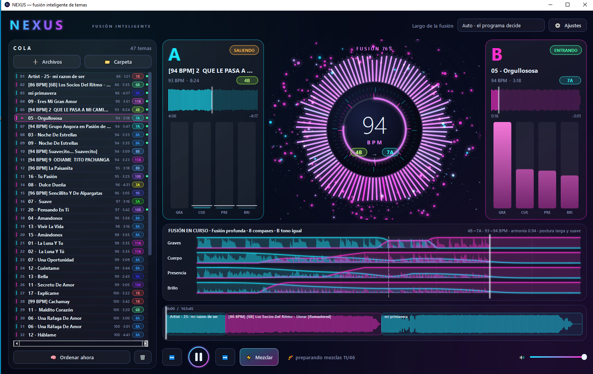

<h1 align="center">🌀 NEXUS</h1>

<b>Dos temas que suenan como uno solo.</b> 
Cargás tus canciones, apretás play y NEXUS <b>analiza cada par, decide cómo fundirlos y los mezcla solo</b>, 
con el compás siempre pegado, el bajo relevado en la línea justa y sin que el tema que entra llegue "cortante".

<b>100 % gratis · para Windows · sin registrarte en ningún lado</b>

  

> 🎧 **¿Una fiesta, un cumpleaños, una reunión, o simplemente tu música sonando sin cortes?**
> Armás la cola, le das play y te olvidás: NEXUS prepara las mezclas antes de que hagan falta y los temas se van fundiendo uno con otro, parejos y en tempo.

---

## ✨ Lo que lo hace especial

NEXUS no baja un tema y sube otro: **funde** los dos. Analiza cada tema (tempo, tonalidad, beats, compases, voz, graves, energía) y **diseña una fusión distinta para cada par**.

- **🥁 El compás nunca se pierde.** Los dos temas se alinean sobre la misma rejilla de beats: el tempo se desliza de A a B mientras suenan juntos y B termina en su tempo real. Sin golpes dobles.
- **🧠 Postura automática.** Según el par (diferencia de tempo, armonía, choque de voces, bajo) NEXUS elige una postura: *larga y suave*, *estándar*, *cuidando las voces* o *firme y corta*. Casi no hay nada que ajustar a mano.
- **🎚 Bajo relevado sobre la línea de compás.** Nunca suenan dos graves a la vez; el cambio cae exactamente en la línea.
- **⚡ Mezclar ya.** Un botón mezcla el tema que suena con el siguiente **desde donde va**: calcula la fusión en segundos mientras el tema sigue sonando.
- **⚡ Rápido.** Las fusiones se calculan en segundo plano y quedan guardadas: la próxima vez que uses esos dos temas, se cargan al instante.
- **🔊 Empalmes exactos.** Al empezar y al terminar la fusión el audio es idéntico al original: sin clics ni saltos.
- **🖱 Se ve lo que va a pasar.** La línea inferior muestra toda la mezcla; en cada deck, una marca naranja/verde muestra **dónde está programado el enganche**, y con un clic o arrastre sobre la onda saltás a ese punto.
- **📚 Cada tema se analiza una sola vez.** El análisis queda en una base de datos local; si renombrás o movés el archivo no se vuelve a analizar. Los temas repetidos (mismo nombre de archivo) no se agregan dos veces.
- **🧠 Orden inteligente.** Reordena la cola para que cada tema encaje con el siguiente.

### 🎛 Ideas de mezcla (se activan con un tilde en Ajustes)
Cada una se suma a la mezcla y se puede apagar cuando quieras:

| Idea | Qué hace |
|---|---|
| **Confianza de rejilla** | Si los beats de un tema no son fiables (en vivo, popurrí, tempo que se mueve), mezcla con la postura segura. |
| **Mezclar por estructura** | La fusión empieza y termina en cambios de sección y no pisa un estribillo con otro. |
| **Armonía activa** | Sube o baja el tono de B durante la fusión para que encaje con A, y lo devuelve a su tono real al terminar. |
| **Voces por frases** | El relevo de voz se hace en un hueco de voz de A. |
| **Aprender de mis gustos** | Aparecen 👍/👎 junto a ⚡: votás cada mezcla y NEXUS ajusta las posturas a tu estilo. |
| **Puentes** | Si dos temas no combinan (tempos muy distintos o armonía y voces que chocan), usa filtro y eco en vez de forzar la fusión. |
| **Arco del set** | El orden de la cola sigue una curva de energía: arranca sereno, sube hasta un pico, respira y cierra arriba. |

---

## ⬇️ Probalo ahora

### Windows, fácil (no necesita Python)
1. **Bajá [`NEXUS-Setup.exe`](https://github.com/gustavomayoraz/NEXUS_DJ/releases/latest/download/NEXUS-Setup.exe)** (descarga directa de la última versión; todas están en [Releases](https://github.com/gustavomayoraz/NEXUS_DJ/releases)).
2. **Doble clic.** Baja solo todo lo necesario (Python 3.14 propio y las librerías, unos 700 MB la primera vez) y abre NEXUS.
3. **Listo:** después se abre desde el acceso directo del Escritorio. Se desinstala desde *Aplicaciones y características*.

> Si Windows muestra "Windows protegió su PC", tocá *Más información* → *Ejecutar de todas formas* (el programa es nuevo y no está firmado).

### Desde el código
    pip install -r requirements.txt
    python NEXUS.py

Requiere Python 3.13 o 3.14. La primera vez, NEXUS descarga las librerías dentro de la carpeta `libs/` y de ahí en más arranca solo y sin internet.

## Cómo se usa
1. **Arrastrá archivos o carpetas** a la cola de la izquierda (o usá ➕ Archivos / 📁 Carpeta).
2. Apretá ▶. Los temas se analizan en segundo plano y las fusiones se preparan antes de que hagan falta.
3. **⚡ Mezclar** para enganchar ya con el siguiente; **🧠 Ordenar ahora** para reordenar la cola.
4. Teclas: `Espacio` play/pausa · `F` fusión ya · `N` siguiente · `P` anterior. Clic o arrastre sobre la línea inferior para moverte por toda la mezcla.
5. **⚙ Ajustes**: largo de la fusión, tipo de fusión (*Natural* o *Por capas*, experimental), postura (Automática o Manual) y las ideas de mezcla.

---

## 🔬 Por dentro
- **Motor en vivo (por defecto):** receta de cruce con corte de graves a 150 Hz; B entra a nivel pleno y A cae con una curva coseno; pausa en el medio del cruce con el relevo de graves sobre la línea de compás; estirado de tiempo WSOLA (cambia la velocidad sin cambiar el tono); rejilla de beats suavizada con ajuste robusto. Si la diferencia de tempo es muy grande cae al motor por capas.
- **Por capas (experimental):** separa cada tema en batería, bajo, voz/melodía y ambiente.
- **Planificador:** puntúa todos los compases de salida de A × entrada de B × largo (armonía, tempo, energía, solape de voces, frases de 8 compases).
- **Base de datos local:** `datos/nexus.db` (SQLite). Guarda los análisis y las fusiones (máx. ~2 GB; se borran las más viejas).

## 💬 Me ayudás un montón si me contás qué te pareció
NEXUS es **gratis y lo hago por gusto**. Lo único que pido es saber si lo usás y si te gustó:

- ⭐ **Dejale una estrella** al repositorio (arriba a la derecha).
- 🗣 **Contame tu experiencia** (qué te gustó, qué mejorarías, qué falló) en [Issues](https://github.com/gustavomayoraz/NEXUS_DJ/issues).

## Datos locales
El programa crea las carpetas `datos/` (análisis, mezclas guardadas y configuración) y `libs/` (librerías) junto al script. No se suben al repositorio.

## Créditos
Desarrollado por Gustavo Mayoraz con la ayuda de [Claude](https://claude.ai) (Anthropic), la herramienta de IA que se usó para programarlo. Hermano de [AutoMix](https://github.com/gustavomayoraz/AutoMix_DJ).

Palabras clave: DJ, auto DJ, mezcla automática, fusión de temas, beatmatching, BPM, tonalidad Camelot, mezclador de dos decks, Python, PySide6, librosa.
